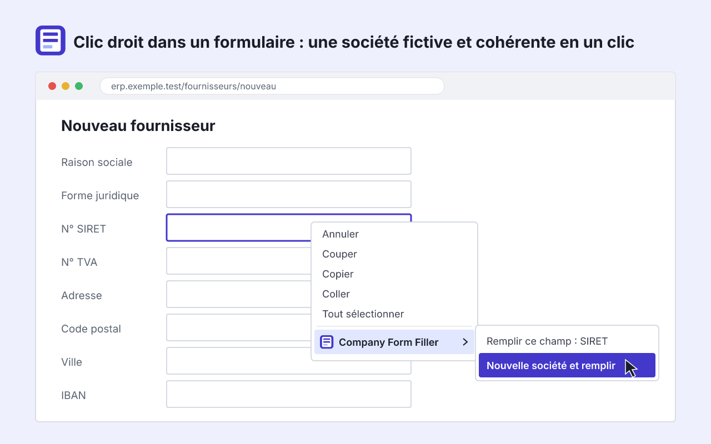

# Company Form Filler

[](https://github.com/Thodebug/company-form-filler/actions/workflows/ci.yml)

**Page de démonstration : https://thodebug.github.io/company-form-filler/**

Extension Firefox, Chrome et Edge pour tester des formulaires français. Un clic droit dans un
formulaire le remplit avec une société ou une adresse fictive mais cohérente : SIRET, TVA,
code NAF, adresse réelle, dirigeant, IBAN, codes comptables et ERP.

Anciennement **SIRET Form Filler** (v1), qui ne générait que des SIRET et SIREN.



## Fonctionnalités

- **Clic droit**, sous-menu « Company Form Filler » :
  - « Remplir ce champ : SIRET » (ou tout autre type reconnu) avec la société de l'onglet ;
  - « Remplir le formulaire avec la société en cours » ;
  - « Nouvelle société et remplir », ou « Nouvelle adresse et remplir » sur un formulaire
    d'adresse ;
  - « Annuler le dernier remplissage ».
- **Détection** de 42 types de champs, en français et en anglais. Un formulaire découpé en
  sections est rempli en entier ; des blocs répétés (facturation et livraison) ne le sont que
  pour le bloc cliqué. Les champs génériques (email, téléphone, nom) ne déclenchent jamais le
  menu à eux seuls.
- **Société cohérente** : SIREN et SIRET valides, TVA calculée, NAF 2025 et son équivalent
  rév. 2, forme juridique et capital compatibles, commune réelle pondérée par la population
  (métropole et DOM) avec ses coordonnées, téléphones dans les plages réservées à la fiction,
  emails en `example.com`, IBAN et RIB valides d'une banque fictive, GLN, codes comptables et
  ERP.
- **Remplissage** au format attendu par le champ (espaces, `+33`, date, NAF sans point...),
  listes déroulantes par synonymes, React, Angular, Vue et masques de saisie pris en compte,
  bandeau de résultat et annulation.
- **Société de l'onglet** : un même onglet garde sa société jusqu'au changement de page.
- **Popup** : générer une société ou une adresse sans quitter la page.
- **Fiche** : toutes les données, copie au clic, verrous par section, historique des 20
  dernières sociétés, 100 favoris avec étiquette, thème clair ou sombre.
- **Navigation privée** : rien n'est écrit sur le disque.

## Installation

**Firefox 142+** : [addons.mozilla.org](https://addons.mozilla.org/firefox/addon/siret-form-filler/)

**Chrome et Edge 123+** :

1. Télécharger `company-form-filler-chromium-X.Y.Z.zip` depuis la
   [dernière release](https://github.com/Thodebug/company-form-filler/releases/latest) et le
   décompresser.
2. Ouvrir `chrome://extensions` (ou `edge://extensions`) et activer le mode développeur.
3. Supprimer la v1 (SIRET Form Filler) si elle est installée.
4. « Charger l'extension non empaquetée » et choisir le dossier.
5. Recharger les onglets déjà ouverts.

## Limites

- Aucune plage de SIREN n'est réservée aux tests : un numéro généré peut correspondre à une
  entreprise réelle, y compris un entrepreneur individuel. À utiliser en environnement de test.
- Non pris en charge : `contenteditable`, cases à cocher et boutons radio, listes déroulantes
  dessinées en JavaScript (select2, PrimeNG Dropdown, MUI...), autocomplétions d'adresse (API
  Adresse, Google Places), formulaires répartis sur plusieurs cadres, étapes d'assistant pas
  encore affichées.
- La société de l'onglet n'est pas vidée par un changement de vue d'une application monopage
  (`pushState`), seulement par un rechargement ou une navigation.
- Sous Chrome et Edge, le menu peut s'ouvrir avec l'état précédent ; le clic revérifie alors
  le champ et n'écrit rien s'il ne convient plus.
- Les favoris et l'historique sont propres au profil du navigateur : ils sont perdus en cas de
  réinstallation.

## Développement

```sh
npm ci
npm run check            # lint, types, tests, build et web-ext lint
npm run start:firefox    # lance Firefox avec l'extension
npm run start:chromium   # lance Chromium avec l'extension
npm run build:data       # régénère les communes et la NAF (réseau requis)
npm run store-images     # régénère les illustrations de la fiche AMO
```

Il n'y a pas d'étape de compilation : les fichiers de `extension/` sont ceux qui sont publiés.
`npm run build` écrit un manifeste et un zip par navigateur dans `dist/`.

Les cas de détection sont décrits dans `test/fixtures/detection.html` (`data-expected="<type>"`)
et le vocabulaire dans `extension/vocab/fr.js`.

Documentation : [spécification](docs/SPEC.md), [architecture](docs/ARCHITECTURE.md),
[recette manuelle](docs/RECETTE.md), [sources des données](LICENSE-DATA.md).

## Structure du projet

```
extension/
  manifest.json           manifeste commun aux navigateurs
  background/             menu, société des onglets, stockage, données
  generators/             génération des sociétés (aléa, clés de contrôle, assemblage)
  data/fr/                communes, NAF, formes juridiques, noms...
  vocab/fr.js             types de champs reconnus
  shared/                 formats, outils et style des pages
  content/                détection, remplissage, bandeau
  popup/                  popup du bouton
  viewer/                 fiche société
  _locales/fr/            textes de l'interface
site/                     page de démonstration et politique de confidentialité
test/                     tests et fixtures
scripts/                  build, données, icônes, images de la fiche, contrôle de version
store/amo/                textes et images de la fiche addons.mozilla.org
docs/                     spécification, architecture, recette, image du README
.github/workflows/        vérifications, GitHub Pages, releases
```

## Publier une version

La version de `package.json` et celle de `extension/manifest.json` doivent être identiques. Un
tag `vX.Y.Z` déclenche le workflow de release : release GitHub avec les zips, et soumission à
AMO si les secrets `AMO_JWT_ISSUER` et `AMO_JWT_SECRET` sont définis. La description et les
captures de la fiche AMO se mettent à jour à la main (`store/amo/listing.md`).

## Confidentialité

Aucune donnée n'est collectée ni envoyée, aucune requête réseau. Les sociétés générées, les
favoris et les réglages restent dans le stockage local du navigateur. Voir la
[politique de confidentialité](https://thodebug.github.io/company-form-filler/confidentialite.html).

## Licence

Le code est publié sous licence MIT (voir [LICENSE](LICENSE)). Les données embarquées viennent
de sources publiques sous Licence Ouverte 2.0 (voir [LICENSE-DATA.md](LICENSE-DATA.md)).

Le code a été écrit avec un assistant IA (Claude).
